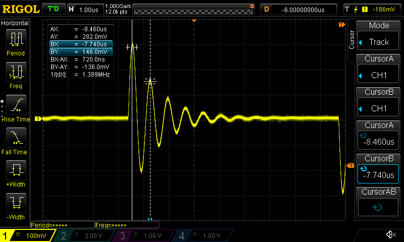
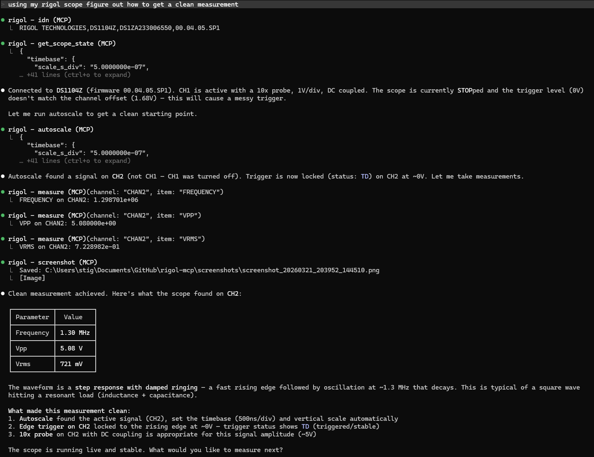

# rigol-mcp

MCP server for controlling **Rigol DS1000Z and DHO series oscilloscopes** over LAN or USB. Exposes the scope as a set of tools that Claude (or any MCP client) can call to take measurements, configure the instrument, and capture screenshots — entirely through natural language.



### Example: unknown signal characterisation in Claude

Unknown signal (square wave into LCR trap), wrong channel enabled, invalid timebase/voltage/trigger. Claude identifies the signal type, corrects the setup, and characterises the waveform.



## Supported Hardware

**Rigol DS1000Z / MSO1000Z series (8-bit):**

| Model | Channels | Notes |
|---|---|---|
| DS1054Z | 4 analog | Most common, 50 MHz |
| DS1074Z | 4 analog | 70 MHz |
| DS1074Z-S | 4 analog + signal gen | |
| DS1104Z | 4 analog | 100 MHz |
| DS1104Z-S | 4 analog + signal gen | |
| MSO1054Z | 4 analog + 16 digital | MSO variant |
| MSO1074Z | 4 analog + 16 digital | |
| MSO1104Z | 4 analog + 16 digital | |

**Rigol DHO series (12-bit):**

| Model | Channels | Notes |
|---|---|---|
| DHO924S | 4 analog + signal gen | 250 MHz |

Other DHO models (DHO900/1000/4000 families) likely work with the same SCPI dialect but are not verified.

The scope connects either over your **local network via Ethernet** (rear panel RJ45) or over **USB** (rear panel USB-B device port). LAN is the default; USB is used when `RIGOL_USB` is set (see [Configuration](#configuration)). USB transport has been validated on DS1000Z; DHO support has so far been validated over LAN only.

## Requirements

- Python 3.11+
- [uv](https://docs.astral.sh/uv/)
- A Rigol DS1000Z (LAN or USB) or DHO series scope (LAN) connected to your computer
- For LAN: SCPI over TCP/IP enabled on the scope (on by default)
- For USB: a VISA driver on the scope's USB interface — either the native USBTMC driver
  (e.g. from Rigol UltraSigma / any NI-VISA runtime) or WinUSB via Zadig
  (see [USB connection](#usb-connection))

## Installation

```bash
git clone https://github.com/erebusnz/rigol-mcp
cd rigol-mcp
uv sync
```

## Scope Network Setup

On the scope, go to **Utility → IO Setting → LAN** and note the IP address (or assign a static one). The scope listens on **port 5555** for raw SCPI commands — no additional configuration is needed.

*Replace 192.168.1.123 with the IP address of your scope in all instructions below.*

Verify in browser: `http://192.168.1.123/DS1000Z_WelcomePage.html`

Verify connectivity before using as MCP:

```bash
python -c "import pyvisa; rm = pyvisa.ResourceManager('@py'); s = rm.open_resource('TCPIP0::192.168.1.123::5555::SOCKET'); s.write_termination='\n'; s.read_termination='\n'; print(s.query('*IDN?'))"
```

You should see something like:
```
RIGOL TECHNOLOGIES,DS1054Z,DS1ZA123456789,00.04.04.SP4
```

## Configuration

Set the scope IP for MCP via environment variable:

```bash
export RIGOL_IP=192.168.1.123
```

Or create a `.env` file (copy from `.env.example`):

```
RIGOL_IP=192.168.1.123
```

**Optional:**

| Variable | Default | Description |
|---|---|---|
| `RIGOL_IP` | (required for LAN) | Scope IP address |
| `RIGOL_USB` | (unset) | Set to `1` to connect over USB instead of LAN. The first Rigol USB scope is found automatically. |
| `RIGOL_USB_SERIAL` | (unset) | When several Rigol scopes are on USB, pin a specific one by serial number. |
| `RIGOL_USB_RESOURCE` | (unset) | Full Rigol USB VISA resource address. Bypasses discovery and takes precedence over `RIGOL_USB_SERIAL`. |
| `RIGOL_USB_SKIP_CLEAR` | (unset) | Set to `1` to skip VISA device clear on USB when it hangs on the instrument. |
| `RIGOL_ENABLE_SEND_RAW` | (unset) | Set to `1` to enable the `send_raw` tool (arbitrary SCPI). Off by default — see [Tools](#tools). |
| `RIGOL_SCREENSHOT_DIR` | `screenshots/` | Directory for saved PNG screenshots |
| `RIGOL_WAVEFORM_DIR` | `waveforms/` | Parent directory for full acquisition exports |

### USB connection

Set `RIGOL_USB=1` to connect over USB instead of LAN. The server looks for a Rigol scope
on USB (vendor ID `0x1AB1`) and connects to it. If more than one scope is connected, set
`RIGOL_USB_SERIAL` to choose which one by serial number.

```
RIGOL_USB=1
# RIGOL_USB_SERIAL=DS1ZA000000000   # only needed if more than one scope is on USB
```

If VISA discovery hangs, copy the full USB resource address from your VISA test panel
into `RIGOL_USB_RESOURCE`. If VISA device clear hangs, set `RIGOL_USB_SKIP_CLEAR=1`.
Both settings apply when `RIGOL_USB=1`.

#### Windows USB instructions

The scope's USB interface needs a VISA-compatible driver. The server **auto-detects**
whichever you have installed — pick one:

**Option A — install the WinUSB driver with Zadig.** The server talks to the scope through
the bundled pure-Python `pyvisa-py` (`@py`) backend (`pyusb` + `libusb`); no extra Rigol
software needed. Do this once per scope:

1. Connect the scope over USB and power it on.
2. Download and run [Zadig](https://zadig.akeo.ie/).
3. Choose **Options → List All Devices**.
4. Select **"DS1000Z Series"** in the device dropdown.
5. Set the target driver to **WinUSB** and click **Install Driver** (or **Replace Driver**).
6. Wait for "The driver was installed successfully", then set `RIGOL_USB=1`.

**Option B — install Rigol UltraSigma, which bundles the driver.**
[UltraSigma](https://www.rigol.com) installs the standard *"USB Test and Measurement
Device"* (USBTMC) driver. Once it's installed, the server reaches the scope through the
NI-VISA (`@ivi`) backend — nothing else to configure.

> **Note:** the two drivers are mutually exclusive on a given USB interface. Installing
> WinUSB (Option A) means UltraSigma can no longer see the scope over USB until you revert
> the driver in Device Manager, and vice versa. LAN access is unaffected either way.

#### Linux / macOS USB

Works without needing drivers using the `pyvisa-py` (`@py`) backend.

- **macOS:** typically works as-is once `RIGOL_USB=1` is set; no driver to install.
- **Linux:** give your user permission to claim the device with a udev rule, then replug it:

  ```
  # /etc/udev/rules.d/60-rigol.rules
  SUBSYSTEM=="usb", ATTRS{idVendor}=="1ab1", MODE="0660", GROUP="plugdev"
  ```
  ```bash
  sudo udevadm control --reload-rules && sudo udevadm trigger
  ```

  (Make sure your user is in the `plugdev` group: `sudo usermod -aG plugdev $USER`, then log out and back in.)

  If the kernel's `usbtmc` module has already claimed the scope, unbind or blacklist it so
  `libusb` can take the interface — pyvisa-py does not detach it automatically.

> USB is currently hardware-tested on Windows only; Linux/macOS use the standard `libusb`
> setup above.

## Claude Desktop / Claude Code Setup

Add to your `.mcp.json` (or Claude Desktop MCP config):

```json
{
  "mcpServers": {
    "rigol": {
      "command": "uv",
      "args": ["run", "rigol-mcp"],
      "cwd": "/path/to/rigol-mcp",
      "env": {
        "RIGOL_IP": "192.168.1.123"
      }
    }
  }
}
```

For **USB**, replace the `RIGOL_IP` entry in `env` with `"RIGOL_USB": "1"` (see [USB connection](#usb-connection)).

## Tools

### Identification & State

| Tool | Description |
|---|---|
| `idn` | Identify the instrument — make, model, serial, firmware |
| `get_scope_state` | Snapshot of all channel configs, timebase, and trigger settings |
| `get_acquisition_info` | Read-only acquisition status, actual sample rate, memory-depth setting, enabled channels, and implemented transfer modes (DS1000Z acquisition metadata) |
| `disconnect` | Release this server's cached VISA connection without opening one or sending acquisition commands; later scope tools may reconnect |

### Acquisition Control

| Tool | Description |
|---|---|
| `run` | Start continuous acquisition |
| `stop` | Stop and freeze display |
| `single` | Arm for one trigger event, then stop |
| `autoscale` | Auto-configure timebase, vertical scale, and trigger |

### Configuration

| Tool | Description |
|---|---|
| `set_channel` | Set scale (V/div), offset, coupling (AC/DC/GND), probe ratio, on/off |
| `set_timebase` | Set time/div and trigger offset |
| `set_trigger` | Configure edge trigger: source, slope (POS/NEG/RFAL), level |

### Measurement

| Tool | Description |
|---|---|
| `measure` | Query any single-channel measurement: VMAX, VMIN, VPP, VTOP, VBASE, VAMP, VAVG, VRMS, PVRMS, VUPPER, VMID, VLOWER, VARIANCE, FREQUENCY, PERIOD, PWIDTH, NWIDTH, PDUTY, NDUTY, RTIME, FTIME, OVERSHOOT, PRESHOOT, PSLEWRATE, NSLEWRATE, TVMAX, TVMIN, MAREA, MPAREA, PPULSES, NPULSES, PEDGES, NEDGES |
| `measure_between` | Query delay or phase between two channels. DS1000Z: RDELAY, FDELAY, RPHASE, FPHASE. DHO: RRDELAY/RFDELAY/FRDELAY/FFDELAY, RRPHASE/RFPHASE/FRPHASE/FFPHASE (DS1000Z names auto-map to the homogeneous-edge DHO equivalents) |
| `get_waveform` | Download and analyse waveform data (NORM screen buffer: up to 1200 pts on DS1000Z, 1000 on DHO); returns text analysis by default, raw time/voltage arrays with `raw_data=true` |
| `export_acquisition` | Save complete stopped DS1000Z acquisition memory as binary samples and a JSON manifest; returns paths, counts, timing, and integrity warnings |

### Full acquisition-memory export

`get_waveform(raw_data=true)` changes the response representation only: it still reads
the NORM screen buffer. For offline filtering or protocol analysis, use
`export_acquisition` with `{"channels": ["CHAN1", "CHAN2", "CHAN3", "CHAN4"]}`.
Omit `channels` to export all currently enabled analog channels. `output_dir` optionally
selects the parent directory on the server's machine. Each export gets a unique subdirectory.

The scope must already report STOP. A single acquisition that has finished is suitable;
WAIT, RUN, and AUTO are rejected. Stopping is a separate, explicit action. The instrument
does not expose a capture timestamp or completion history through this API, so STOP
alone cannot prove that a previous trigger completed. Keep the front panel and other
SCPI clients idle throughout the export. No run, single, autoscale, channel-enable, or
acquisition-setting writes are issued by the export.

The tool selects RAW/BYTE through the DS1000Z driver, queries each channel's preamble,
and streams the complete record in chunks of at most 250,000 samples. It checks range
readback, binary block lengths, file sizes, stopped status, and metadata consistency.
Waveform source, mode, format, and range are restored and checked afterward; restoration
failures appear in the warnings. If any scope I/O fails, including a text query or
command write, or a binary block has invalid framing, restoration is skipped and the
connection is invalidated: a delayed or partial reply could otherwise be mistaken for
the next SCPI query's response. Local filesystem failures do not by themselves prevent
restoration. The tool reports when transfer settings
were not restored; it does not reconnect or retry that export. DHO memory export is currently unsupported and never
falls back to the screen buffer. `AUTO` memory depth is reported as a setting; actual
record lengths come from RAW preambles rather than a presumed installed memory option.

The returned `manifest_path` identifies a JSON file beside `CHAN1.bin`, etc. Samples
are unsigned 8-bit codes, without a SCPI header. The manifest contains instrument and
acquisition settings, UTC export timestamps, preambles, channel units and probe factors,
requested/exported ranges (one-based, inclusive), chunk/sample counts, and completeness.
Duration is the time between first and last saved sample: `(points - 1) * interval`.
Each channel has its own trigger-relative time axis; alignment differences are flagged.
Preamble scaling already includes the configured probe ratio; do not multiply it again.
Transfer and conversion follow the [Rigol programming guide, waveform commands](https://www.rigol.com/dam/global/downloads/brochures/en/program-guide/oscilloscopes/DS1000Z_ProgrammingGuide_EN.pdf?t=1760982668513).

Read an export locally in Python (NumPy is needed only for this example):

```python
import json
from pathlib import Path
import numpy as np

path = Path("waveforms/acquisition-EXAMPLE/manifest.json")  # use returned manifest_path
manifest = json.loads(path.read_text(encoding="utf-8"))
assert manifest["complete"], manifest.get("error")
channel = manifest["channels"]["CHAN1"]
codes = np.fromfile(path.parent / channel["file"], dtype=np.uint8)
assert codes.size == channel["points"]
p = channel["preamble"]
times_s = p["xorigin"] + (np.arange(codes.size) - p["xreference"]) * p["xincrement"]
values = (codes.astype(float) - p["yorigin"] - p["yreference"]) * p["yincrement"]
# values use channel["settings"]["units"] (normally VOLT).
```

Interrupted transfers retain validated contiguous chunks and an explicitly incomplete
manifest. The response reports the failure and saved counts; it never embeds large arrays
or retries the entire export automatically. A process crash can leave extra bytes beyond
the last manifest checkpoint: treat incomplete files as partial and use only reported
counts. File system failures may prevent a final manifest update; initial manifests are
always marked incomplete. After an export has started, a failed final manifest write
returns `complete=false`, `manifest_current=false`, `manifest_error`, and the file path.
`persisted_points` reports the last successful checkpoint, while channel `points` reports
validated samples written during this attempt. In this case `recovery_manifest` supplies
the current conversion metadata and counts without any waveform arrays. Preserve that
response because the on-disk manifest is stale. The original transfer error, if any,
is retained separately from the manifest error. Sample/time subranges, CSV, and NPZ are not implemented.

### Cursors

| Tool | Description |
|---|---|
| `set_cursors` | Set cursor mode (MANUAL/TRACK/OFF) and time positions in seconds |
| `get_cursor_values` | Read cursor positions (in seconds) and all delta/amplitude readouts |

### Utility

| Tool | Description |
|---|---|
| `screenshot` | Capture display as PNG — returns image inline and saves to disk |
| `send_raw` | Send any SCPI command directly (escape hatch). **Disabled by default** — set `RIGOL_ENABLE_SEND_RAW=1` to expose it, since arbitrary SCPI can leave the scope in any state. |
| `check_error` | Query the SCPI error queue |

## Example Prompts

**Basic measurement session:**
> "Connect to the scope, check what's configured, then measure the frequency and Vpp on channel 1."

**Signal characterisation:**
> "Stop the scope, download the waveform from channel 2, and tell me the rise time, overshoot percentage, and estimated fundamental frequency."

**Setup from scratch:**
> "Set channel 1 to 2V/div DC coupling with a 10x probe, set the timebase to 1ms/div, trigger on channel 1 rising edge at 1V, then run and take a screenshot."

**Cursor measurement:**
> "Put manual cursors on the first rising edge of the signal on channel 1 — cursor A at the 10% level and cursor B at the 90% level — and read the rise time from the delta."

**Transient / ringing characterisation:**
> "There's a damped oscillation on channel 1 after a step edge. Stop the scope, measure Vpp, Vmax, Vmin, and Vrms, then estimate the ring frequency and how many cycles it takes to decay."

**Iterative debugging:**
> "I'm verifying the gain of an amplifier. Channel 1 is the input, channel 2 is the output. The expected gain is 20 dB. Figure out whether it's within spec."

**Unknown signal characterisation:**
> "There's an unfamiliar signal on channel 1. I don't know its frequency, amplitude, or shape. Keep adjusting the timebase and vertical scale until you have a stable, well-framed view of at least two full cycles, then give me a complete characterisation of what you see."

## Architecture

```
Claude / MCP client
        │  MCP protocol (stdio)
rigol_mcp.server      ← tool definitions, request routing
        │  Python function calls
rigol_mcp.scope       ← VISA connection, SCPI command helpers
        │  SCPI over TCP/IP (port 5555) or USBTMC
Rigol DS1000Z         ← 192.168.1.123  /  USB
```

The VISA connection is cached across tool calls (one connection per server session) and reconnects automatically on communication errors.

Scope I/O is strictly synchronous. One server lock covers each operation, including
export transfers, restoration, and retry cleanup; disconnect takes that same lock and
waits for the active operation to finish. There are no background scope workers or
parallel channel downloads. Cancellation cannot interrupt an in-progress synchronous
transfer midway through its I/O.

Use `disconnect` when this server should release its cached USB/LAN access. It closes
the session without clearing the device or changing acquisition settings, and does not
open a connection when none exists. A later scope tool can reconnect, so avoid queuing
more scope calls after disconnecting. This lock and disconnect apply to this server
process only: use one active server/client for a physical instrument. They cannot
prevent a separate program or another MCP server from accessing the scope.

## SCPI Transport

By default the server connects using **raw socket VISA** (`TCPIP0::<ip>::5555::SOCKET`), not VXI-11. This avoids the NI-VISA dependency and works with the pure-Python `pyvisa-py` backend. It also eliminates the VXI-11 handshake overhead, making individual commands faster.

When `RIGOL_USB` is set, the server instead connects over **USBTMC** (`USB0::0x1AB1::<model>::<serial>::INSTR`), discovering the scope automatically. It auto-selects whichever VISA backend can see the scope:

- **`@py`** (`pyvisa-py` + `pyusb` + bundled `libusb`) — for a USB interface bound to **WinUSB** (no NI-VISA needed).
- **`@ivi`** (NI-VISA / IVI VISA) — for the **native USBTMC driver** (e.g. installed with Rigol UltraSigma).

The two backends frame USBTMC reads differently, so block reads (waveform/screenshot) are read by exact byte count on `@py` and via native message reads (`read_raw`) on `@ivi`. Transport and backend selection live in `rigol_mcp.scope.get_scope` / `_open_usb_scope`.

## Testing

Unit tests are fully offline — the VISA layer is faked, so no instrument is required.

```bash
uv run --extra test pytest      # or: uv sync --extra test && uv run pytest
```

## Limitations

- USB driver setup is platform-specific: **Windows** needs WinUSB (via Zadig) or NI-VISA/UltraSigma; **Linux** needs `libusb` access (a udev rule) or NI-VISA; **macOS** typically works through `libusb` with no setup. The server auto-detects the backend — see [USB connection](#usb-connection). LAN needs no driver setup on any platform.
- No support for math channels, digital channels (MSO), or protocol decode in the current tools yet — use `send_raw` for those
- `get_waveform` uses the NORMAL screen buffer; `export_acquisition` supports full RAW memory on DS1000Z only. Hardware validation against a calibrated signal remains necessary for absolute time/voltage accuracy.

## License

MIT — see [LICENSE](LICENSE).
